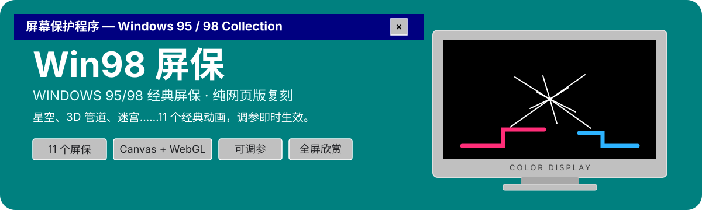
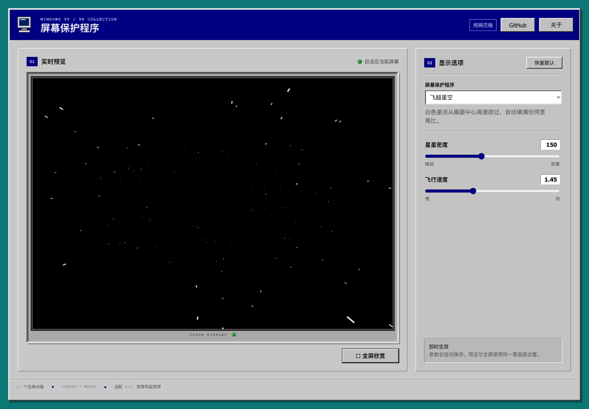

<p align="right"><a href="README.md">中文</a></p>

<p align="center">
  
</p>

<p align="center">
  <a href="https://xiaosang.cc/win98-screen-saver/">▶ Live Demo</a>
  ·
  <a href="https://github.com/holynova/win98-screen-saver">GitHub Repository</a>
</p>

A pure-web remake of the classic Windows 95/98 screen savers: all 11 animations are reimplemented in the browser (Canvas 2D + WebGL) — no system images, no original SCR files, no backend. Preview live inside a CRT monitor frame, tune parameters on the right (saved to your browser automatically), and hit 「全屏欣赏」 ("View Fullscreen") for the real screen-saver experience — move the mouse, click, or press any key to exit.

## Screenshot

<p align="center">
  
</p>

## The 11 Savers

| Saver | Scene |
| --- | --- |
| 飞越星空 (Starfield) | White stars streak outward from the center of the screen, filling any aspect ratio automatically |
| 3D 管道 (3D Pipes) | Colorful pipes of constant radius grow along a 3D grid — glossy elbows and spherical joints crossing black space |
| 3D 迷宫 (3D Maze) | Auto-navigates between red-brick walls, wooden floors, and checkered ceilings, hunting for the yellow smiley-face exit |
| 3D 花盒 (3D Flower Box) | Low-poly colored shapes slowly rotate and bounce, breathing open and closed like a mechanical flower |
| 3D 飞行物体 (3D Flying Objects) | Windows logos, explosions, ribbons, splashes, and textured flags float and morph on screen |
| 3D 文字 (3D Text) | Heavy, glossy 3D text bounces through black space (type `volcano` for a hidden message) |
| 变幻线 (Mystify) | Colored polygons bounce through black space, leaving layered neon trails |
| 飞行的 Windows (Flying Windows) | Colorful four-pane windows fly in from the distance, keeping the low-poly rhythm of the 90s |
| 曲线与色彩 (Curves & Colors) | Bright Bézier curves generated continuously, stacking in old-school VGA colors on a black backdrop |
| 滚动字幕 (Marquee) | Custom text scrolling on a solid background, with the classic random-position mode |
| 空白屏幕 (Blank Screen) | The quietest classic saver: pure black, nothing else |

## Features

- **Live preview**: plays in real time inside a CRT monitor frame; `ResizeObserver` adapts to the window size — 4:3, widescreen, and ultrawide.
- **Tunable**: every saver has its own controls (range/select/toggle/text/color); changes restart the animation 120ms later and apply immediately.
- **Auto-save**: the selected saver and every parameter are stored in `localStorage` (prefix `win98-screen-saver:`) and survive refresh; one-click restore defaults.
- **Fullscreen saver**: a dedicated fullscreen engine (DPR capped at 2); 800ms after starting, a mouse move over 18px, a click, or any key exits; falls back to a window-filling view when the browser doesn't support fullscreen.
- **About dialog**: a classic Win98-style title-bar dialog describing the project and version (v0.1.0).

## Tech

- TypeScript + Vite 8, `three` 0.185 (WebGL savers), the rest on Canvas 2D; build output goes to `docs/` (`tsc --noEmit && vite build`).
- Each saver is an independent module (`src/savers/`) implementing a shared `SaverDefinition` interface (id, name, description, defaults, controls, `create`); the engine drives updates and rendering by `dt`, reseeding on every switch.
- Tests: Vitest, 3 test files, 7 cases (`math.test.ts`, `index.test.ts`, `maze.test.ts`), run with `npm test`.

```
src/
  core/     engine.ts (main loop / DPR / size adaptation), three-saver.ts, math.ts, types.ts, settings.ts
  savers/   one module per saver (11) + index.ts registry
  ui/       app.ts (shell, preview, fullscreen, about dialog), icons.ts
  storage.ts  localStorage read/write (settings + current selection)
```
